### hi, olaph here

I build small tools that keep running after I close the laptop: dashboards that refresh every half hour, bots that watch markets, an Android app or two because the one I wanted didn't exist.

Most of it sits in private repos. The public bits:

**Running**
- [Frontier Pulse](https://itsolaph.github.io/frontier-pulse/) reads Entropy's 24/7 pre-IPO perps and turns them into what the market thinks Anthropic and OpenAI are worth. Unofficial, updates on its own.
- [XDM](https://github.com/itsolaph/xdm) is a download manager for Android, in the spirit of 1DM and IDM+. Kotlin and Compose.
- [x429: Skip the Line](https://github.com/itsolaph/x429-checkout) is a PayBox plugin for busy APIs. When one answers 429, your agent can pay a cent or two in USDC on Base to jump the queue, and every agent it passes gets paid for its spot. One of the 13 PayBox Hackathon finalists; [demo video](https://x.com/olaph_lol/status/2115066777822745084).

**On the bench** (hackathon builds, still moving)
- [Shadowright](https://github.com/itsolaph/shadowright) gives a wallet agent a learner's permit on Sui. It earns autonomy one category at a time instead of getting the keys on day one.
- [Keepalive](https://github.com/itsolaph/keepalive) does USDC subscriptions on Arc that refund every epoch the service was down.
- [DotGas](https://github.com/itsolaph/dotgas) lands you on Portaldot with gas in your wallet: pay on Base, get tPOT, make your first transaction.

**Done**
- [Close Call leaderboard](https://closecall.lol) was a live board for FLOP Labs' NVDA contest on technocore.chat. Every row is checked against the referee's signature in your browser, so you don't have to trust me.

Stack changes with the project. Lately it's TypeScript, Python, Kotlin, some Solidity, and a lot of cron.

Off the keyboard: an anime backlog I will never finish and whatever game is eating my weekend.

[x.com/olaph_lol](https://x.com/olaph_lol)
