### hi, olaph here

I build small things that keep running after I close the laptop: dashboards that refresh every half hour, agents that watch money, an Android app or two because the one I wanted didn't exist.

Most of it sits in private repos. The public bits:

**Live**
- [Frontier Pulse](https://itsolaph.github.io/frontier-pulse/) reads Entropy's 24/7 pre-IPO perps and turns them into what the market thinks Anthropic and OpenAI are worth. Unofficial, updates on its own.
- [x429: Skip the Line](https://x429.lol) is a PayBox plugin for busy APIs. When one answers 429, your agent can pay a cent or two in USDC on Base to jump the queue, and every agent it passes gets paid for its spot. Took 1st place in the first PayBox Hackathon; [demo video](https://x.com/olaph_lol/status/2115066777822745084).
- [Keepalive](https://itsolaph.github.io/keepalive/) sells USDC subscriptions by the epoch, and a missed heartbeat is the refund. On Arc mainnet, no support tickets involved.
- [XDM](https://github.com/itsolaph/xdm) is a download manager for Android, in the spirit of 1DM and IDM+. Kotlin and Compose.

**Building**
- [Outlive](https://github.com/itsolaph/outlive) sells a running service instead of its code: an NFT on NEAR that holds an API's treasury, price list and customers, so selling the token hands over the business while callers keep calling.
- [Shadowright](https://github.com/itsolaph/shadowright) gives a wallet agent a learner's permit on Sui. It earns autonomy one category at a time instead of getting the keys on day one.
- [Nightshift](https://github.com/itsolaph/nightshift) is a payments operator for small PayPal merchants: it catches the lapsed authorizations, failed captures and double refunds that quietly lose money, and fixes the safe ones itself. Running on a [sandbox account](https://nightshift-usur.onrender.com).

**Past builds**
- [Close Call leaderboard](https://closecall.lol) was a live board for FLOP Labs' NVDA contest on technocore.chat. Every row is checked against the referee's signature in your browser, so you don't have to trust me.
- [Poltergift](https://itsolaph.github.io/poltergift/) is a secret gift exchange on the Tari Ootle where the chain sees equal gifts in and unlinkable claims out, and nobody learns who gave what to whom.
- [Family Archive Weaver](https://github.com/itsolaph/family-archive-weaver) turns a folder of old family recordings into a browsable archive, with every uncertain name or date flagged instead of guessed.

Stack changes with the project. Lately it's TypeScript, Python, Kotlin, some Solidity and Rust, and a lot of cron.

Off the keyboard: an anime backlog I will never finish and whatever game is eating my weekend.

[x.com/olaph_lol](https://x.com/olaph_lol)
